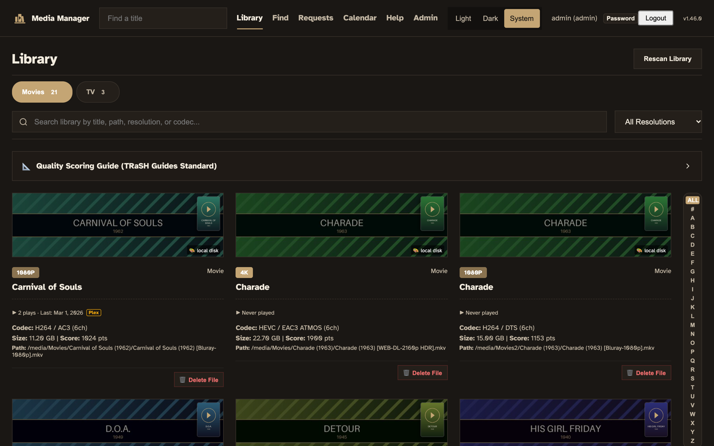
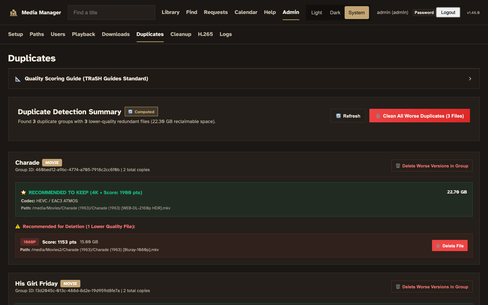
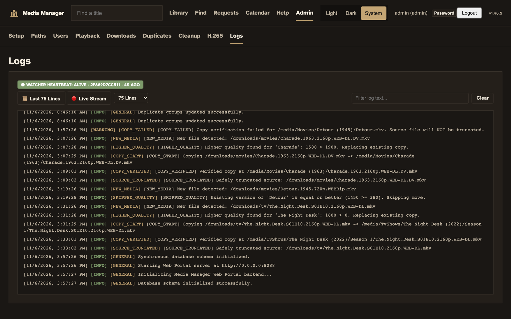
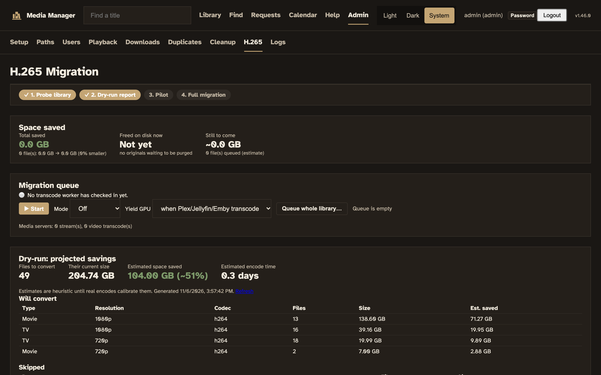
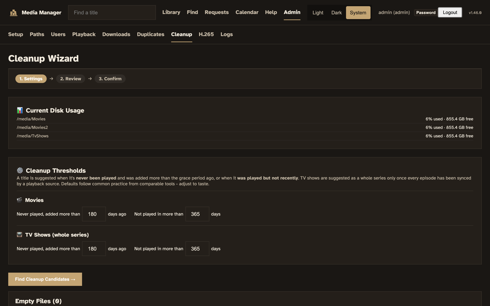
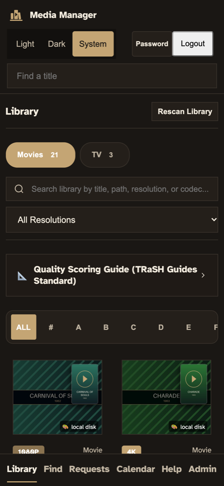
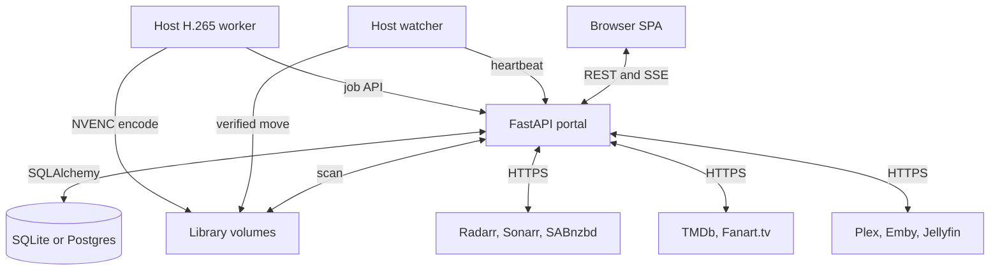

<picture>
  <source media="(prefers-color-scheme: dark)" srcset="docs/brand/header-dark.png">
  <source media="(prefers-color-scheme: light)" srcset="docs/brand/header-light.png">
  
</picture>

# Media Manager

[](https://github.com/ohallord/media-manager/actions/workflows/ci.yml)
[](LICENSE)

Media Manager is a self-hosted web portal for a home movie and TV library. It
has a FastAPI backend, a plain JavaScript single-page app, and SQLite or
Postgres for storage.

I wanted one place to see and manage my media, and a way for friends and
family to see what's on my servers or available to request. I also needed to
keep an eye on my files and folders and find where I could save space.

It started as a simple search-and-request page. Each time I asked what else it
could handle, it grew: duplicate checks, a verified file mover, H.265
conversion, and a feed of upcoming movies and TV shows.

## Key features

### Library inventory

A scan walks every directory in `MEDIA_DIRECTORIES` with ffprobe and stores
resolution, codecs, HDR format, audio channels, bitrate, and size for each
file. Search covers the local library and Radarr/Sonarr in one box. Remote
lookups are time-boxed, so a broad query returns JSON before a reverse proxy
gives up on it.

### Duplicate ranking

Files for the same title are grouped and ranked by a quality score: 4K beats
1080p, Atmos beats TrueHD, TrueHD beats DTS, and bitrate breaks ties. The best
copy is marked in the UI.

### The verified file mover

The watcher process monitors the download folders in `SOURCE_DIRECTORIES`.
When a new file scores higher than every copy already in the library (or
there is no copy yet), the watcher copies it into place, checks that the copy exists and has the same
non-zero size as the source, and only then truncates the source. Every move,
failed or not, gets a row in the audit log.

### Radarr/Sonarr integration

You can add a title to Radarr or Sonarr from search results, Coming Soon,
Trending, or the title detail view, and pick the quality profile when you do.
For a movie that is part of a TMDb collection, the detail view shows every
film in the collection and how many of them you own.
The Downloads page merges the Radarr/Sonarr queue with SABnzbd and Syncthing,
and you can remove, retry, or re-search a stuck grab from there.
My Requests shows each user what they asked for and whether it is requested,
downloading, or available. When a request becomes available, the requester
gets one email (if SMTP is set up), and can turn that off on the same page.

### GPU H.265 migration

A host worker re-encodes H.264 and XviD files to HEVC on an NVIDIA GPU with
`hevc_nvenc`. It starts with a dry-run savings report, then a hand-picked
pilot, then the whole library largest-savings-first. The original is kept for
a configurable number of days after each swap.

## Screenshots

These come from a demo library of public-domain films and made-up shows.

The library, with quality, codec, and play counts on each card:



Duplicates ranked by quality score, with the copy to keep marked:



The mover's log trail for a verified copy, a skipped lower-quality file, and a failed check:



The H.265 dry-run report before anything is encoded:



The cleanup wizard's thresholds, and the library on a phone:





## How it fits together



The portal is the only process that opens the database. The watcher and the
H.265 worker run on the host and talk to the portal over HTTP.

## Quick start

You need Python 3.11, ffmpeg, and git. Run the setup script from a clone:

```bash
git clone https://github.com/ohallord/media-manager.git
cd media-manager
./setup.sh
```

`setup.sh` creates a virtualenv, installs dependencies, and writes `.env` with
a random `JWT_SECRET` and an admin password. The password is printed once, so
save it. Start the portal and open `http://localhost:8088`:

```bash
source .venv/bin/activate
set -a && source .env && set +a
python3 main.py serve
```

On first login the app asks you to change the generated password. There is no
default password: if `INITIAL_ADMIN_PASSWORD` is unset, no admin account is
created.
There is no default `JWT_SECRET` either: if it is unset, the app generates a
random one and stores it next to the database. Changing a password signs out
every other session.

Connect your services under **Admin → Setup**: Radarr, Sonarr, and the rest
under Connections, and Plex, Emby, and Jellyfin under Media servers.

To run it with Docker instead:

```bash
docker build -t media-manager .
docker run -d --name media-manager -p 8088:8088 \
  -e JWT_SECRET="$(openssl rand -hex 32)" \
  -e INITIAL_ADMIN_PASSWORD="$(openssl rand -base64 18)" \
  -e DB_PATH=/config/media.db -v media-manager-config:/config \
  -e MEDIA_DIRECTORIES=/media/Movies,/media/TvShows \
  -v /path/to/movies:/media/Movies -v /path/to/tv:/media/TvShows \
  media-manager
```

Read the password back with `docker inspect` if you didn't note it. The Helm
chart in `k8s/helm/`, the systemd units, and the full configuration reference
are in [docs/INSTALL.md](docs/INSTALL.md).

## Design notes

### Copy, verify, then truncate

The mover never deletes a download. It copies the file, compares sizes, and
truncates the source to zero bytes only after the check passes. A failed check
leaves the source untouched and logs `[COPY_FAILED]`.

TODO(Dan): explain why the source is truncated instead of deleted.

### The cleanup wizard never deletes on its own

The cleanup wizard lists movies and series that nobody has watched in a
configurable number of days, using play counts from Plex, Emby, and Jellyfin.
It deletes nothing by itself. An admin reviews each suggestion and confirms
the deletion.

### The transcoder yields to playback

Before and during each encode, the portal checks Plex, Emby, and Jellyfin for
active sessions. By default the worker pauses ffmpeg while a media server is
transcoding video, and it resumes when the GPU is free. It won't swap a file
that someone is watching. The swap waits and retries every 60 seconds.

## Known limits

- The H.265 worker targets NVIDIA NVENC. A CPU `libx265` mode exists
  (`TRANSCODE_ENCODER=libx265`), but it's mainly used in CI tests.
- The watcher and the H.265 worker run as systemd services on a Linux host.
  The Docker image runs only the portal by default.
- SQLite is the default database. The portal is the only process that writes
  to it, so you can't run more than one portal replica against SQLite.
- After an H.265 swap, Plex, Emby, and Jellyfin are told to rescan. Radarr and
  Sonarr aren't.
- You set up integrations (Radarr, Sonarr, SABnzbd, TMDb, Fanart.tv, SMTP) in
  the Admin UI after login. There are no environment variables for them.

The full feature list is in [docs/FEATURES.md](docs/FEATURES.md), and the
architecture is in [docs/SYSTEM_DESIGN.md](docs/SYSTEM_DESIGN.md).

## Development

Run the tests through the wrapper script. It points `DB_PATH` at a throwaway
SQLite file, so tests never touch a real database:

```bash
pip install -r requirements.txt coverage
bash scripts/run_tests.sh              # tests only
bash scripts/run_tests.sh --coverage   # tests and a coverage report
coverage report --fail-under=90
```

CI runs the same commands on every push and fails below 90% line coverage.

## What I'd change

TODO(Dan): write this yourself.

## Legal use

Media Manager is for organizing media you have the right to keep, such as discs
you own or shows you recorded. It doesn't host or index content, and it isn't
meant for piracy. Follow the copyright law where you live.

## License

MIT. See [LICENSE](LICENSE).
