# Media Manager — System Architecture & Technical Design

## 1. Architectural Overview

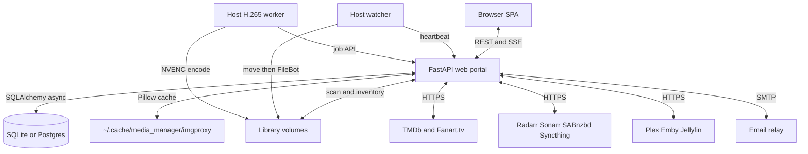

The portal is the only process that opens the database. The host watcher moves
completed downloads into the library root, then FileBot AMC (strict, queried by Sonarr's
series title from the filename; `media_manager/filebot.py`) files them as `Show/Season N/` or `Movie/`; a Sonarr-named
episode AMC can't identify is filed from its name (`file_sonarr_episode`); any
other unidentified file stays in the root, where Plex won't list it. The watcher also
heartbeats the portal. The host transcoder claims jobs
over HTTP and never opens the database. Playback sync, cleanup suggestions, and
the H.265 queue all run inside the portal process.

---

## 2. Multi-Tier Caching Pipeline (Artwork & Metadata)

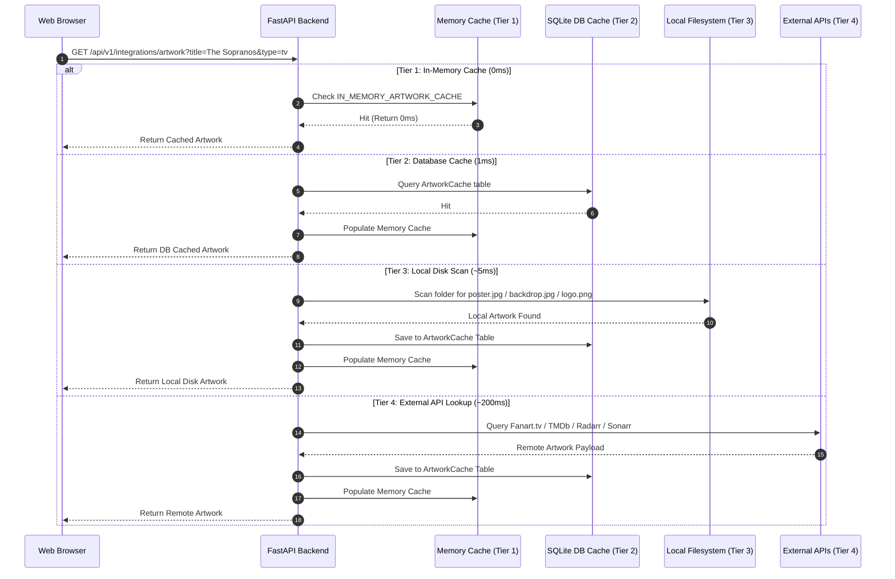

---

## 3. TV Show Extraction & Letter Index Filtering Flow

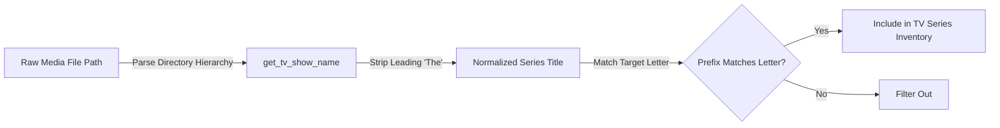

### Series Title Parsing Rule
- Paths containing `/Season X/` resolve to `parent_dir(Season X)`.
- Leading `"The "` is ignored during letter index comparisons so `"The Sopranos"` indexes under **S**, `"The Big Bang Theory"` indexes under **B**, and `"The Handmaid's Tale"` indexes under **H**.

---

## 4. Automated Testing & Verification

Run the automated test suite via the isolated-DB wrapper - **never** `python3 main.py test`,
`python3 -m unittest discover`, or a bare `coverage run` directly. On a checkout that also
runs the watcher, the default `DB_PATH` is the live database, and the wrapper points the
tests at a throwaway SQLite file instead:
```bash
bash scripts/run_tests.sh              # run the suite
bash scripts/run_tests.sh --coverage   # run the suite + coverage report
```

### Test Coverage
90+ test files under `tests/`, one per source module/router area (e.g.
`tests/test_inventory.py` for TV show title parsing and letter-index matching,
`tests/test_api_auth.py` for authentication/authorization, `tests/test_api_integrations*.py`
for the Radarr/Sonarr/TMDb-backed endpoints). There are **36** `tests/test_*.py`
files. Target: **90%+ overall coverage**,
enforced in CI via `coverage report --fail-under=90` on every `main` push and
merge request.

---

## 5. Recyclarr / TRaSH Guides Synchronization Architecture

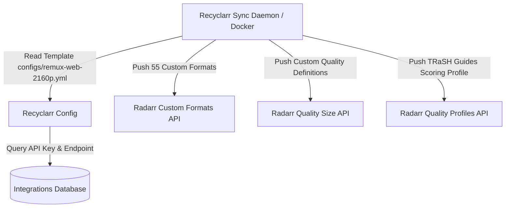

- **Custom Formats**: Groups releases based on properties such as Atmos audio, HDR10/DV codecs, release groups, and unwanted qualities (3D, AV1, LQ releases).
- **Scoring**: Mapped inside the `TRaSH Guides Scoring Profile` to ensure optimal release ranking during automatic search and download.

---

## 6. SMTP Relay & Storage Capacity Verification Pipeline

### Integration API authentication
Every `/api/v1/integrations/*` route requires a logged-in user
(`get_current_active_user` on the router). Discovery (Coming Soon, Trending,
artwork/metadata), download queues (SABnzbd, Syncthing, Radarr/Sonarr), and
the image proxy are not public. Admin-only mutations still use `get_admin_user`.

### Bootstrap admin (fails closed)
`POST /api/v1/auth/login` creates the first admin only when no user row
exists for `INITIAL_ADMIN_USER` and the password matches
`INITIAL_ADMIN_PASSWORD` (constant-time compare). There is no default
password: unset or empty means the bootstrap is disabled and every login
fails until an admin exists (`python3 main.py reset-password` creates one).
The bootstrapped admin has `must_change_password` set, so the env value is
a one-time credential. Tests: `tests/test_initial_admin_fail_closed.py`.

### SMTP Notification Relay
Email notification dispatch runs asynchronously inside the web portal using an asyncio-supported executor threadpool:
1. **Login 2FA Code**: If a user attempts password login with 2FA enabled via email, a 6-digit verification code is generated, saved in memory, and relayed to the user's email address using the configured SMTP server.
2. **Password Recovery Code**: Enables self-service password resets from the login card.

Both one-time codes (`web/api/auth.py`) come from `secrets.randbelow`, are compared with `hmac.compare_digest`, expire after `CODE_TTL_SECONDS` (10 min), and the `temp_token` is dropped after `MAX_CODE_ATTEMPTS` (5) wrong guesses; at most `MAX_CODES_PER_WINDOW` (5) codes are issued per user per 10 min (2FA login returns 429, forgot-password quietly returns a decoy), so a 6-digit code cannot be brute-forced. `POST /auth/forgot-password` returns the same `{status, temp_token}` for unknown users and users with no email/phone (a decoy token that never verifies), so it is not a username oracle. Pending codes are per-process memory, so a restart cancels them.

Sessions: each JWT carries the user's `token_version` as `tv`. Every password change (self-service, reset, or admin reset) bumps `users.token_version`, so all older tokens stop working; the browser that changed its own password gets a fresh cookie. Disabled users (`is_active = false`) cannot log in and their tokens are ignored. The cookie is `HttpOnly`, `SameSite=Lax`, and `Secure` when the request arrived over HTTPS (`COOKIE_SECURE`, default `auto`). Logs (`/api/v1/logs/*`) and `POST /inventory/scan` are admin only. `/add` only accepts a `root_folder_path` that Radarr/Sonarr already lists.
3. **H.265 migration mail**: daily summaries, failure-streak alerts, and worker-silent alerts from `web/services/transcode_notify.py` (§16.7).
4. **Download-stack health alerts**: `web/services/integration_health.run_health_checks` runs on every 60 s `transcode_scheduler` sweep. For each enabled Radarr/Sonarr/SABnzbd config it calls the client's `get_status()`; for Radarr/Sonarr it also reads `/api/v3/health` and treats a `DownloadClientCheck` or `DownloadClientStatusCheck` entry as "can't reach its download client". The result is stored in `IntegrationConfig.status` (`HEALTHY`, `UNREACHABLE`, `DOWNLOAD_CLIENT_ERROR`; the Admin > Integrations badge) and an email goes out only when it changes: one when a problem starts (after 2 failing checks in a row, so a single timeout is ignored) and one on recovery. Because the state is in the DB, a pod restart does not re-send. Recipients are the H.265 notify list (`TranscodeControl.notify_emails`, all active admins if blank). SMS is not sent: `User.phone` stores no carrier, so there is no free email-to-SMS address to use.

### Real-Time Storage Space Monitoring
Storage directories are monitored dynamically via `shutil.disk_usage` and rendered with a sleek visual progress bar:
- **Red Alert ($\le 10\%$ left)**: Critical low space threshold.
- **Yellow Warning ($10\% - 15\%$ left)**: Low space warning threshold.
- **Green OK ($> 15\%$ left)**: Healthy capacity threshold.

---

## 7. Coming Soon Discovery Flow (Movies & TV)

```mermaid
flowchart TD
    UI[Coming Soon UI - Movie/TV toggle] -->|GET /upcoming-movies or /upcoming-tv| API[FastAPI Backend]
    API -->|discover/movie or discover/tv, cached 6h per day-window| TMDB[TMDb API]
    API -->|Filter: has overview+poster+date, popularity floor| Filtered[Filtered Candidate List]
    Filtered -->|_get_cast_and_trailer, batched & cached| Cast[Top-5 Cast + Trailer]
    Filtered -->|Movies only: /movie/id/release_dates, batched & cached| Releases[US Release-Type Breakdown]
    Filtered -->|TV only: /tv/id/external_ids + /tv/id/watch/providers, batched & cached| TvExtra[TVDB ID + Streaming Providers]
    Releases -->|Exclude: prior US theatrical release + only a streaming/digital release in window| Exclude[Drop already-released titles]
    API -->|Check local MediaItem titles + Radarr/Sonarr library| Status[in_library / in_radarr|in_sonarr / not_added status]
    Status --> UI
    UI -->|POST /add-by-tmdb or /add-tv-by-tmdb| API
    API -->|Movies: lookup_movie_by_tmdb_id| Radarr[Radarr API]
    API -->|TV: external_ids -> lookup_series_by_tvdb_id| Sonarr[Sonarr API]
```

- **Movies** (`/upcoming-movies`): theatrical vs. streaming distinction and the
  prior-theatrical-release exclusion both come from `/movie/{id}/release_dates`'s
  per-country release-type breakdown, which TMDb doesn't expose for TV.
- **TV** (`/upcoming-tv`): scoped to *new series premieres* (`first_air_date` in
  the lookahead window) - a different, complementary view from Calendar, which
  shows episode-level air dates for shows already tracked in Sonarr. No
  theatrical concept applies, so streaming providers are shown informationally
  via `/tv/{id}/watch/providers` rather than date-gated like movies. Sonarr is
  TVDB-keyed, so adding a TMDb-discovered show first resolves its `tvdb_id` via
  `/tv/{id}/external_ids`.
- List endpoints cap filtered TMDb results at 40 (highest popularity) and
  fetch cast without person bios (`include_bios=False`) so Coming Soon /
  Trending do not fan out one `/person` call per billed actor. Detail views
  still request bios. Inventory list payloads already include
  `poster_url` / `backdrop_url` / overview / rating from
  `_populate_media_details`; the SPA paints those instead of N+1
  `/artwork`+`/metadata` fetches per card.
- The add confirmation sheet includes **Grab now** vs monitor-only
  (`search_now`). Failures use `showToast` rather than `alert()`. My Requests
  joins `/download-queue` by title so in-progress grabs show a percent.
- Inventory `DELETE /items/{id}` and `POST /duplicates/delete-worse` return
  409 when `volume_is_healthy` is false (empty/unmounted volume), matching
  the watcher purge safety rule.

---

## 8. Download Queue Aggregation

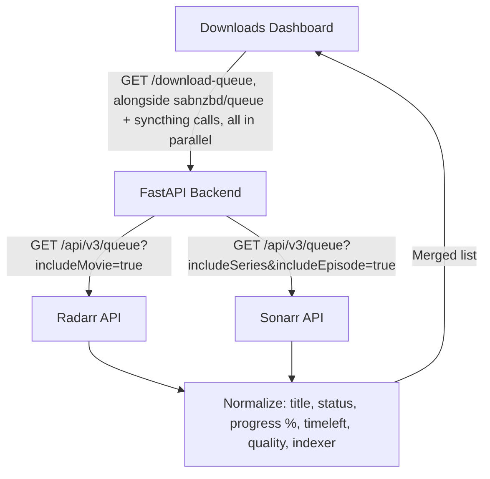

- Distinct from the existing `/sabnzbd/queue`: SABnzbd's queue reflects the raw
  NZB download job, while Radarr's/Sonarr's own queue tracks the
  grab-to-import lifecycle tied to a specific movie/episode (so it still shows
  an item during post-download import/processing, after the NZB job itself has
  already left SABnzbd's queue).
- Rendered as a fourth card on the existing Downloads dashboard
  (`downloads.js`), reusing its existing 3s smart-polling-while-active logic.

---

## 9. My Requests Status Correlation

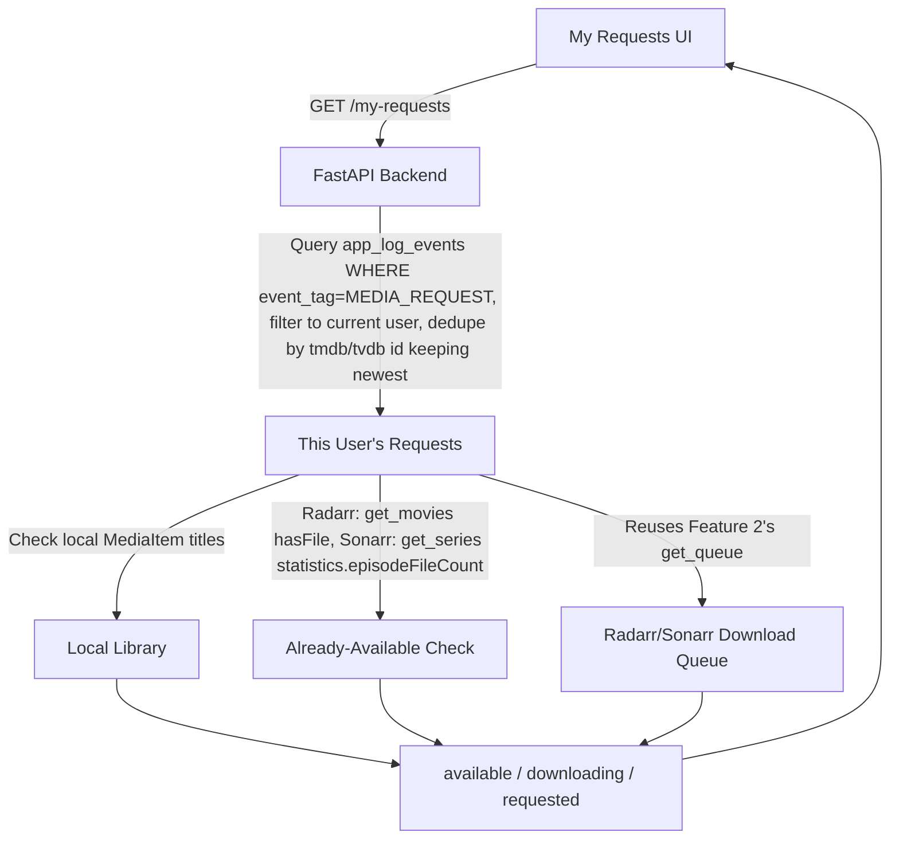

- Request history has no dedicated table - it's derived from the same
  `[MEDIA_REQUEST]` `app_log_events` rows that already power the "Requested by"
  badges on Coming Soon/Calendar (`_get_request_user_mappings`), just scoped to
  the current user and deduplicated by title/ID instead of aggregated across
  all users.
- Status priority is available > downloading > requested: a title already in
  the local library or with `hasFile`/`episodeFileCount > 0` in Radarr/Sonarr
  is "available" even if it also happens to still be in the queue (e.g. a
  repeat/upgrade search).
- Cards are enriched with the same poster/overview/genres/cast/trailer detail
  Coming Soon and Trending show inline (fetched concurrently per request via
  `get_movie_details`/`get_tv_details` + `_get_cast_and_trailer`, split by
  media type since a single user's requests are a mix of movies and TV) and
  are clickable through to the Feature 5 detail modal - added shortly after
- Cards are enriched with the same poster/overview/genres/cast/trailer detail
  Coming Soon and Trending show inline (fetched concurrently per request via
  `get_movie_details`/`get_tv_details` + `_get_cast_and_trailer`, split by
  media type since a single user's requests are a mix of movies and TV) and
  are clickable through to the Feature 5 detail modal - added shortly after
  the initial ship, once it became the odd one out (bare title+badge list)
  next to every other discovery page's rich cards.
- The SPA also `GET /download-queue` in parallel and overlays `progress_pct`
  when a request title matches a queue row.

---

### 9a. "Request ready" emails

- Status logic lives in `web/services/request_status.py`
  (`load_requests` → `apply_statuses`), shared by `GET /my-requests` and the
  `request_notify_scheduler` started in the web lifespan (every 15 min).
- `web/services/request_notify.py` returns early when the `email` integration
  is disabled. Its first sweep writes a `__baseline__` row in
  `request_notifications`; only requests newer than that are considered.
  Each (user, dedupe key) gets one row once handled: `emailed=True` after a
  successful send, `emailed=False` for opted-out, email-less or unknown users.
  A failed send writes nothing, so the next sweep retries.
- Opt-out: `users.notify_on_available` (default true), shown via `GET /auth/me`
  and set with `PUT /auth/me/notifications` from the My Requests checkbox.

## 10. Trending Cache Flow

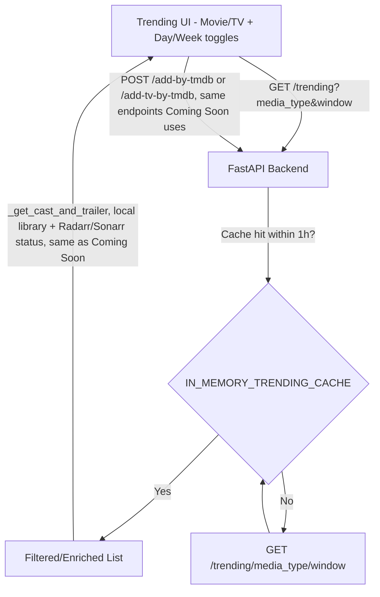

- Independent of release date - TMDb's `/trending` endpoint ranks by current
  popularity, not upcoming release windows, so this is a genuinely different
  discovery mode from Coming Soon (which it otherwise shares almost all
  enrichment/status/add logic with).
- Cached for 1 hour per `(media_type, window)` pair - much shorter than
  Coming Soon's 6-hour discover cache, since trending shifts daily.
- Cast/trailer, watch-provider, network, and TVDB-id enrichment is time-boxed
  (`TRENDING_ENRICH_TIMEOUT_SECONDS` plus per-batch `_bounded_id_fetches`) so a
  stalled TMDb/DNS call returns the title list as JSON instead of hanging until
  the ingress 504 HTML page (which the SPA used to try to `JSON.parse`).

Search Media (`GET /api/v1/integrations/search`) uses the same idea:
`SEARCH_REMOTE_TIMEOUT_SECONDS` around Radarr/Sonarr lookup,
`SEARCH_LIBRARY_IDS_TIMEOUT_SECONDS` around library ID maps, and
`SEARCH_ENRICH_TIMEOUT_SECONDS` around `_populate_media_details`. The SPA
parses those responses with `parseApiJson` so a remaining 502/504 HTML body
shows a timeout message instead of `JSON.parse: unexpected character`.

---

## 11. Title Detail Modal / Similar-Recommended Flow

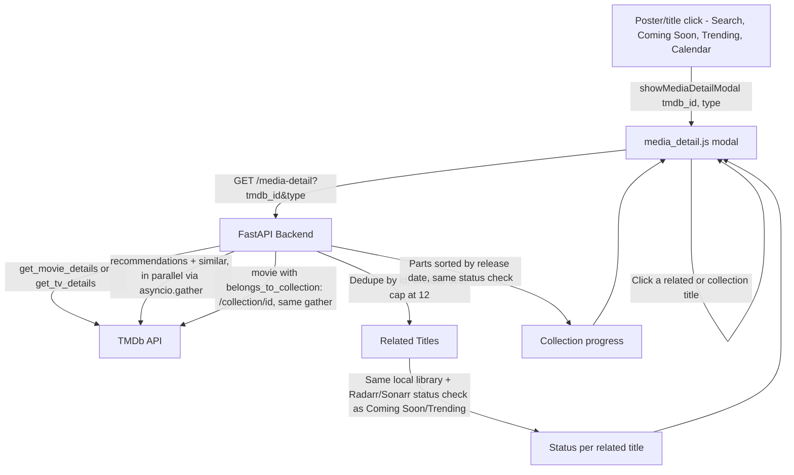

- No new detail *page* - this app has no per-title route, so one reusable
  modal (`media_detail.js`, using the same dynamically-created-`<div>` pattern
  as `showAddMediaModal`) is wired into every card type that already has a
  `tmdb_id` available, rather than duplicating a detail view per page.
- Calendar's TV events didn't originally carry a `tmdb_id` (Sonarr/TVDB-keyed).
  They now attach `tvdb_id` and resolve TMDb via metadata cache and
  `/find/{tvdbId}` so poster/title clicks open the same detail modal as movies.
  Inventory posters/titles with a cached `tmdb_id` open it too, and the modal
  lists matching on-disk files (resolution / score / size).
- Add confirmation can pick a **quality profile** and (TV) **all vs first season**.
- Downloads Radarr/Sonarr queue rows can **remove**, **retry** (warning/error),
  or **search now**.
- Admin and Logs show a **watcher heartbeat**. The host watcher POSTs
  `/api/v1/watcher/heartbeat` into the Kubernetes-hosted database (checkout SQLite is a
  different file than `/config/media.db`). Default URL is the host NodePort
  `http://127.0.0.1:18088/...` because `media.local` does not resolve here.
  `WATCHER_HEARTBEAT_TOKEN` has no default: the endpoint returns 503 until it is
  set on the web app, and the watcher skips the HTTP beat until it is set there.
- "More Like This" merges `/recommendations` and `/similar` (recommendations
  first), capped at 12 titles, each clickable to drill into its own detail
  view - browsing related titles is a chain of modals, not a separate page.
- **Collections** (movies only): when TMDb's movie details carry
  `belongs_to_collection`, `/collection/{id}` is fetched in the same
  `asyncio.gather` as recommendations/similar and returned as `collection`
  (`total`, `owned_count` = in library, `added_count` = in library or Radarr,
  `parts` sorted by release date, undated last). The modal shows it as a
  "you own X of Y" poster row above More Like This. A failed lookup returns
  `collection: null` and never fails the request. There is no bulk
  "add missing" action; each part is added from its own detail modal.

---

## 12. Request-Handling Performance Notes

- **uvicorn runs a single process** (`main.py`'s `uvicorn.run(...)` has no
  `workers=`), so it's one event loop for every concurrent request. Any
  `async def` handler that does blocking work directly (file I/O, CPU-bound
  processing, `shutil.disk_usage`, etc.) stalls *every other in-flight
  request* for its duration, not just its own. `/imgproxy`'s Pillow decode/
  resize/encode and disk-cache reads/writes, and `/logs`'s log-file reads, are
  both wrapped in `asyncio.to_thread(...)` for exactly this reason - keep new
  blocking work off the event loop the same way.
- **`GZipMiddleware`** is registered in `web/app.py` (`minimum_size=1000`),
  compressing the larger JSON payloads (inventory/upcoming/trending) and
  static assets.
- **Pooled HTTP client**: `web/app.py`'s lifespan builds one `httpx.AsyncClient`
  and sets it as `integrations.SHARED_HTTP_CLIENT`; every Radarr/Sonarr/
  SABnzbd/TMDb/Fanart/Syncthing client constructed in `integrations.py` is
  given it, so those ~55 methods reuse pooled TCP/TLS connections instead of
  opening a fresh client per call. See `media_manager/integrations/base.py`
  (`BaseHTTPClient`).
- **`_get_request_user_mappings`** (who requested what, parsed from
  `[MEDIA_REQUEST]` `AppLogEvent` rows) is called from nearly every discovery
  endpoint - search, upcoming-movies/tv, calendar, trending, media-detail,
  metadata. It's cached for 120s using the same hand-rolled TTL-dict pattern
  as the Radarr/Sonarr library caches above (`IN_MEMORY_REQUEST_USER_MAPPINGS_CACHE`),
  rather than re-scanning the full event history on every request.

---

## 13. Playback Tracking (Plex/Emby/Jellyfin)

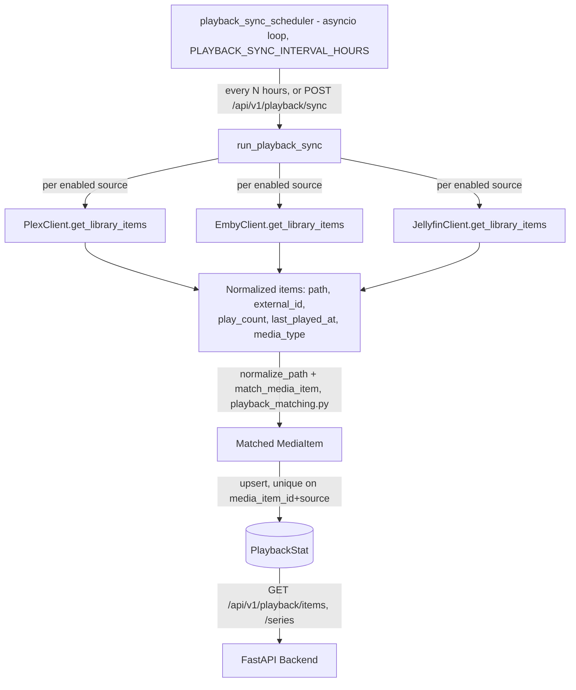

- **Clients** (`media_manager/integrations/plex.py`, `emby.py`,
  `jellyfin.py`) each expose a single normalized `get_library_items()`
  contract so the sync service stays source-agnostic. Emby/Jellyfin sum
  `PlayCount` across every local user for the same item (each user's watch
  is a distinct real event); Plex reflects the single configured token's
  own view (Plex Home per-user breakdown is a known v1 limitation).
- **Matching** (`media_manager/playback_matching.py`, pure functions):
  a per-source `IntegrationConfig.extra_json` can hold
  `{"path_mappings": [{"source_prefix", "local_prefix"}]}` rules for when a
  media server container sees a different mount path than this app's
  scanner does. After remapping, matching is by exact path, falling back to
  a basename match only when it's unambiguous.
- **Storage**: `PlaybackStat` keeps one row per `(media_item_id, source)` -
  raw per-source truth, not pre-merged - so the multi-source merge always
  runs against current data. **Merge strategy**, applied at query time in
  `web/api/playback.py`: merged `play_count`/`last_played_at` is the **max**
  across sources (Plex vs. Emby vs. Jellyfin possibly tracking the same
  physical file - summing would double-count a single watch), while
  same-source multi-user counts are already summed by the client above.
- **Sync**: `web/services/playback_sync.py`'s `run_playback_sync()` loads
  every `MediaItem` once, builds path/basename indexes, then per enabled
  source fetches/matches/upserts and logs a `[PLAYBACK_SYNC]` `AppLogEvent`
  summary (matched/unmatched counts) - there's no UI for this yet, so the
  log is the visibility mechanism. `playback_sync_scheduler()` runs it on a
  timer from `web/app.py`'s lifespan, the same mechanism as the existing
  weekly metadata-sync scheduler (`web/services/metadata_sync.py`).
- **API** (`web/api/playback.py`, prefix `/api/v1/playback`): admin-only
  `GET`/`PUT /config/{service}` and `POST /test/{service}` for
  plex/emby/jellyfin (separate from the generic
  `/api/v1/integrations/config` endpoint, which has no field for path
  mappings; the **Admin → Setup → Media servers** form in
  `admin_integrations.js` drives these and always re-sends the mappings,
  since `PUT` replaces them), `POST /sync` to trigger a sync immediately, and
  `GET /items` / `GET /series` (grouped via the existing
  `get_tv_show_name`, since there's no dedicated series table) to read the
  merged data back - filterable by `media_type`, `unplayed_only`, and
  `min_days_since_played` for future pruning-candidate queries.
- **UI**: play_count/last_played_at/play_sources are attached inline to
  `GET /api/v1/inventory/items` and `GET /api/v1/integrations/media-detail`
  (via the same `web/services/playback_lookup.py` merge helper the API
  above uses), so Inventory movie/TV cards, the TV show header's "Series
  Total," and the shared title detail modal (reused by Search/Coming
  Soon/Trending/Calendar/My Requests) all show play data without a
  dedicated fetch per page. A read-only **Admin → Playback** page
  (`admin_playback.js`) lists every movie/series with a name filter, an
  in-page scroller, and sortable columns (name, type, total plays, last
  play, player(s) played on, added to library), reusing `/api/v1/playback/items` and `/series` rather than a
  new endpoint. Automated (scheduled, no-human-in-the-loop) deletion still
  doesn't exist - the manual, suggest-and-confirm half shipped in §14
  below instead.

---

### Duplicate groups
`quality.update_duplicate_groups` groups by `media_type:title` (plus
`SxxEyy` for TV), keeps the highest `quality_score` as `best_media_id`, and
flushes a new `DuplicateGroup` before linking items so they get its id on the
same run (`tests/test_duplicate_group_first_link.py`).

## 14. Library Cleanup Wizard

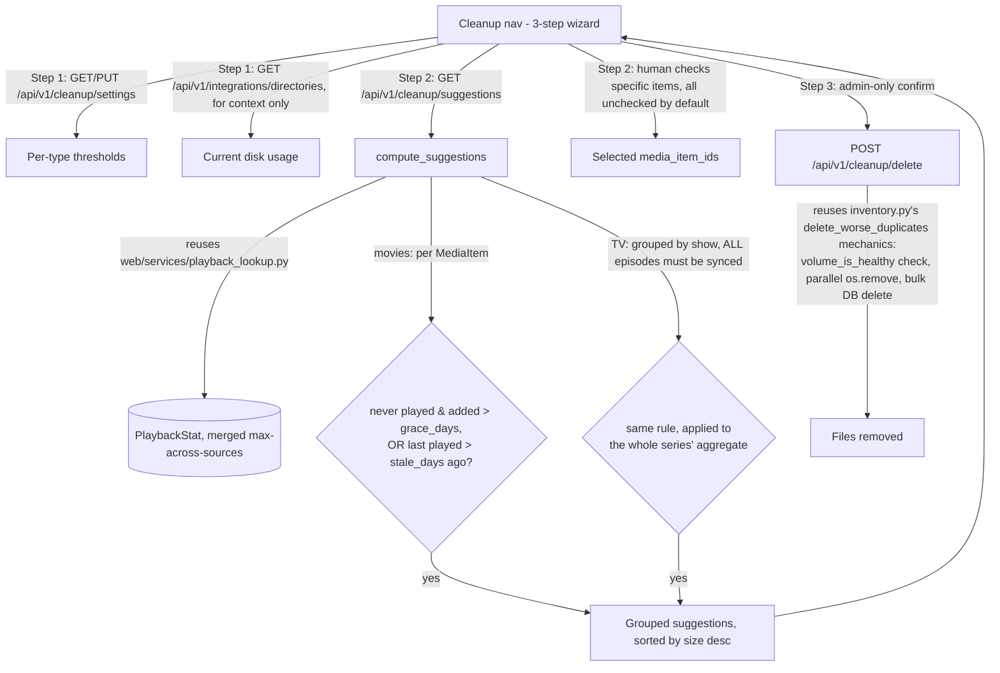

- **Admin-only**: Setup, Paths, Users, Playback, Cleanup, H.265 Migration,
  Downloads, Duplicates, and Logs sit under the Admin nav. On a phone the
  main links are a fixed bottom bar and the Admin subnav scrolls above it.
  Non-admins are
  bounced to Library if they open those hashes (`ADMIN_ONLY_VIEWS` in `auth.js`,
  checked in `navigateTo`). Every `/api/v1/cleanup`, `/api/v1/redownload` and
  `/api/v1/transcode` endpoint requires `get_admin_user` at the router level
  (reads included - they expose library paths).
- **Never automated**: nothing here runs on a schedule or deletes without
  an explicit admin click on Step 3. `CleanupSettings` only stores the
  *suggestion* thresholds, not a deletion trigger.
- **Defaults**: `never_played_grace_days=180`, `stale_after_days=365` per
  media type - researched against comparable self-hosted tools
  (Maintainerr, Reclaimerr), landing conservative since a human reviews
  every suggestion. Configurable per type in Step 1.
- **Safety rule**: an item is only ever suggested if it has at least one
  `PlaybackStat` row (i.e. an actual sync has matched it) - items with zero
  rows are silently excluded, never assumed "unwatched." For TV, *every*
  episode of a show must be synced before the whole series becomes
  eligible, since a series-level suggestion is higher-stakes than one
  movie.
- **TV granularity**: shows are suggested as a whole series (reusing the
  same `get_tv_show_name` grouping Inventory/Playback use), not individual
  episodes - a partially-watched show is left alone by default. A
  suggestion carries every episode's `media_item_id` so Step 3 can submit
  them all as one selection.
- **No new deletion primitive**: `POST /api/v1/cleanup/delete` takes a
  flat list of `media_item_id`s (the frontend flattens selected movies +
  selected shows' episode ids) and runs the exact same safe-delete steps
  `delete_worse_duplicates` already used - this only adds a *selection*
  step on top of mechanics that already existed.

---

## 16. H.265 Migration

Re-encodes the h264/XviD library to HEVC with a host NVENC worker. Phases 1–7
below are built. Switching from a hand-picked pilot to the whole library, and
leaving the page in `full` mode so new downloads auto-queue, are operational
steps on the admin page.

### 16.1 Rich probe metadata (phase 1)

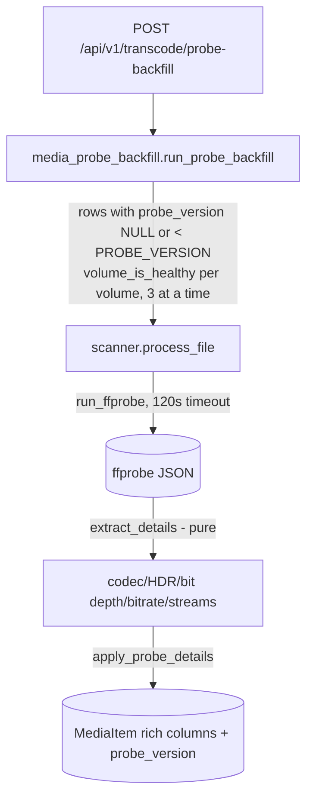

- **New `MediaItem` columns** (all nullable): `video_profile`, `pix_fmt`,
  `bit_depth`, `hdr_format` (`sdr`/`hdr10`/`hlg`/`dv`), `dv_profile`,
  `color_transfer`, `color_primaries`, `field_order`, `frame_rate`,
  `video_bitrate`, `container`, `duration_seconds`, `audio_stream_count`,
  `subtitle_stream_count`, `attachment_count`, `probed_at`, `probe_version`.
  Added to existing DBs via the shared `_MEDIA_ITEMS_COLUMNS` list that
  both `init_db_schema` and `init_db_schema_sync` ALTER in.
- **HDR comes from the stream, not the filename**: Dolby Vision from the
  `DOVI configuration record` side data (with its profile), HDR10 from
  `color_transfer=smpte2084`, HLG from `arib-std-b67`. (The filename-based
  `parse_path_qualities` still drives the quality score for now. `dv` counts
  only as its own release tag, so `dvdrip` and temp directories are not Dolby Vision.)
- **Cover-art fix**: `attached_pic` streams (MP4/M4V poster images) are no
  longer taken as the file's video track, so `video_codec`/`width`/`height`
  reflect the real video.
- **Per-stream video bitrate**: the stream's `bit_rate`, else MKV `BPS` /
  `BPS-eng` tags, else NULL - `bitrate` stays the container total.
- **Backfill** runs in the web pod (it has ffprobe, the mounts, and is the
  only prod DB writer) through the same `process_file` upsert a scan uses,
  so it also corrects rows the old probe got wrong. Missing files, 0-byte
  placeholders and files on unhealthy volumes are counted and skipped, not
  failed. Bumping `metadata.PROBE_VERSION` makes the next backfill re-probe
  every row. `GET /api/v1/transcode/probe-backfill` reports progress and
  DB coverage.

---

## 14b. Empty-File Re-download

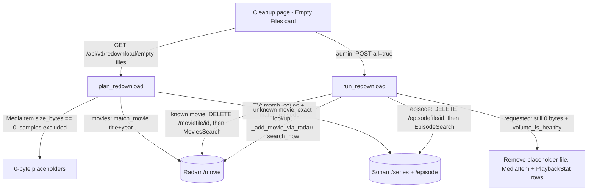

- **Why delete the file record first**: the seedbox Radarr/Sonarr list
  these titles as downloaded (`hasFile=True`, size 0 - the mover truncates
  the seedbox copy after copying it), so a plain search grabs nothing.
  Deleting the 0-byte record makes the title "missing" again. Radarr's
  "unmonitor deleted movies" (and Sonarr's equivalent) then unmonitors it,
  and searches skip unmonitored titles - so items are re-monitored
  (`PUT /movie/editor`, `PUT /episode/monitor`) right before the search.
- **Matching is exact**: normalized title + year for movies (also Radarr's
  `cleanTitle` and folder name), show-folder name for series, season +
  episode number for episodes. Unmatched items are reported (`not_found`,
  `episode_not_found`), not acted on.
- **Auto-add when missing**: a movie Radarr doesn't know is added (with
  search) on an exact title+year lookup hit. A series Sonarr doesn't know is
  added on an exact lookup hit (`Ghosts (US)` = `Ghosts (US)`; `Show (2005)`
  = title `Show` + year 2005) with **nothing monitored and no search** - then
  only the empty episodes are monitored and searched, so a whole show is
  never downloaded. If Sonarr hasn't loaded the new series' episodes yet
  (~30 s wait), the item is `added_pending`: run Re-download again.
- **Down vs. empty**: an empty Radarr/Sonarr library list is followed by a
  status check, so "unreachable" (e.g. the seedbox app is down) is reported
  as such instead of being treated as "not in the library".
- **Placeholder cleanup** happens only after Radarr/Sonarr accepted the
  request, and only if the file is still 0 bytes (or already gone) on a
  healthy volume - so the dead row can't be grouped as a "duplicate" of
  the incoming real file. Each request is logged as `[REDOWNLOAD]`.
- **CLI**: `python3 main.py redownload-empty` previews; `--yes` triggers.

### 16.2 Codec-aware quality score (phase 2)

- `quality.calculate_quality_score(..., video_codec=None, video_bitrate=None)`
  feeds the bitrate tie-breaker an **h264-equivalent** bitrate
  (`effective_bitrate`): the video stream's bits are multiplied by
  `CODEC_EFFICIENCY` (`hevc`/`av1` 2.0, `vp9` 1.6, `h264` 1.0, `vc1` 0.9,
  `mpeg4`/`msmpeg4*` 0.7, `mpeg2video` 0.6); audio bits are left as-is when
  the video bitrate is known. Unknown codec = 1.0, so old callers are
  unchanged. The +150 cap still applies.
- Why: an HEVC transcode at half its source's bitrate would otherwise score
  *lower*, so the mover would refuse it and Delete-Worse-Duplicates could
  remove it. `scanner.process_file` and `mover.move_if_better` pass the codec.
- `media_probe_backfill.rescore_all()` recomputes every row's score from
  stored fields (only changed rows written, 500 per batch). It runs at the
  end of every probe backfill and via admin `POST /api/v1/transcode/rescore`.
- `update_duplicate_groups(protected_ids=...)` never purges the given rows
  as "file missing" - the hook the transcoder's swap lock (phase 4) uses.

### 16.3 Dry-run planning (phase 3)

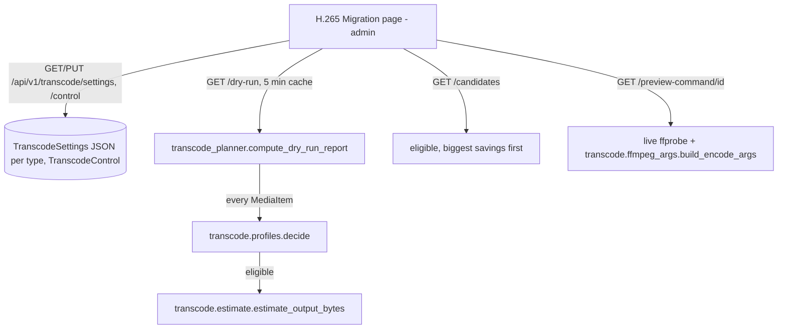

- **`media_manager/transcode/`** is pure (a test forbids DB/web/HTTP imports)
  so the host worker can use it without the app stack:
  `profiles.decide` (eligibility + plan), `estimate` (heuristic size +
  `calibrate` from real results), `ffmpeg_args` (command builder),
  `verify.compare` (post-encode checks).
- **Eligibility, in order**: 0-byte, not probed, already HEVC, codec not
  selected (default h264 + MPEG-4 ASP family), excluded folder (configured
  list + the watcher's download/Syncthing folders, always), type disabled,
  HDR/DV (skipped), 4K (movies kept; TV downscaled to 1080p), interlaced,
  pixel format other than 8/10-bit 4:2:0, video bitrate under the per-
  resolution floor.
- **Defaults** (editable per type), tuned on library samples: movies CQ 22
  p7 fullres multipass; TV CQ 25 p5 qres; 10-bit Main10 output; keep only
  if ≥10% smaller. Measured on a 1080p h264 sample: CQ 20 saved ~43%,
  CQ 24 ~65%, CQ 27 ~76%; TV p5 matched p7's size at 2.7x the speed.
- **Command shape**: `-hwaccel cuda` + `scale_cuda` for 8-bit 4:2:0 h264,
  software decode otherwise (XviD, Hi10P); `hevc_nvenc -rc vbr -cq N -b:v 0
  -maxrate <source video bitrate>`; all audio/subtitle/attachment streams
  and chapters copied; `mov_text` → SRT; MP4 cover art and data tracks
  dropped; stale MKV statistics tags blanked; Matroska output. Sample
  encodes map only the video (a sparse PGS track would make ffmpeg read to
  the end of the file).
- **Settings storage**: `TranscodeSettings.settings_json` holds only the
  overrides and is merged over `profiles.DEFAULTS`, so a new setting needs
  no migration.

### 16.4 Job queue and worker API (phase 4)

Singleton settings rows (`transcode_control` id `global`, and one
`cleanup_settings` row per media type) are created on first use. The H.265
and Cleanup pages fire several requests at once, so `get_or_create_control` /
`get_or_create_settings` catch the `IntegrityError` from a lost insert race,
roll back, and re-select the winner's row (`tests/test_get_or_create_race.py`).

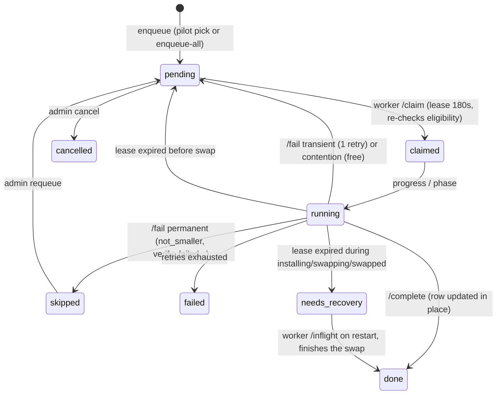

- **Single writer**: the host worker never opens the DB. It authenticates
  to `/api/v1/transcode/worker/*` with `X-Transcode-Token` (the
  `media-manager-transcoder` k8s Secret; unset = 503, no default) and
  `X-Transcode-Protocol` (current or previous version, else 409). Every
  response carries `server_version` so the worker can drain and restart on
  a deploy.
- **Worker endpoints**: `POST heartbeat` (returns `pause` + settings),
  `POST claim` (job or 204), `GET inflight`, `POST jobs/{id}/progress`
  (renews the lease, returns `cancel`), `POST jobs/{id}/phase`
  (write-ahead, never backwards), `POST jobs/{id}/complete` (idempotent),
  `POST jobs/{id}/fail` (`transcode.errors.classify`).
- **Admin endpoints**: `GET /status`, `POST /jobs` (pilot pick),
  `POST /jobs/enqueue-all {confirm}`, `GET /jobs[/{id}]`,
  `POST /jobs/{id}/requeue|cancel`, `PUT /control {run_state, mode}`.
  Claiming needs `run_state=running` and `mode` ≠ off; `mode=pilot` only
  releases pilot jobs. Order: pilot first, then biggest estimated savings.
- **Completion** updates the original `MediaItem` (same id, so playback
  stats and history stay attached) from the worker's output probe,
  recomputes its quality score, merges away any row a scan created at the
  new path mid-swap, writes `FileMoveLog(status="TRANSCODED")`, and clears
  the duplicates/cleanup/dry-run caches.
- **Swap guards**: while a job is installing/swapping/swapped or in
  `needs_recovery`, `update_duplicate_groups` never purges its item as
  "file missing" and `scanner.process_file` skips its output path.
  `transcode_scheduler` (web lifespan) sweeps expired leases every 60 s.
- **Lease keepalive**: the encode loop renews the lease with every
  progress report, but the network copy, `ffprobe -count_packets`, sample
  encodes, the full verify decode and the install copy + re-hash of a big
  (e.g. 45 GB 4K) file each run far longer than the 180 s lease while
  saying nothing. The worker therefore runs a `LeaseKeeper` thread per job
  (and per recovered job) that sends a bare progress call whenever the
  main thread has been quiet for 45 s. If the server answers 409 (the job
  was given away) or `cancel`, the next phase call raises a clean
  `worker_lost` / `worker_shutdown` instead of an "unexpected error".
  Before this, large files were requeued mid-verify, re-encoded, and then
  skipped as `worker_lost` on the second attempt.
- **Worker liveness**: the worker only POSTs `heartbeat` between jobs, so
  `progress` and `phase` calls from the worker that owns the heartbeat row
  also refresh `last_beat_at`. Otherwise any job longer than 10 minutes
  showed the worker offline and sent a false "transcode worker is not
  responding" email.
- At most one active job per file (partial unique index on
  `transcode_jobs(media_item_id)` for active states).

### 16.5 Host worker (phase 5)

`media_manager/transcode/worker.py`, run by `media-manager-transcoder.service`
from the CI-synced checkout `~/media-manager-worker` with the system python3
(stdlib only - no DB, no app dependencies; enforced by the package purity test).

| Step | Worker does | Announced first |
|---|---|---|
| 1 | Pre-flight: volume healthy, source size/mtime = queued snapshot, folder writable, no file at the new path, free space | - |
| 2 | NAS (CIFS/NFS) source: copy to local scratch | `preparing` |
| 3 | Probe (`-count_packets`); optional 3×20 s sample encodes - skip as `predicted_not_smaller` if savings < 1.5 × the minimum | - |
| 4 | Encode to scratch with live progress; pause (SIGSTOP) when the server says so or other GPU encoders appear (resume 120 s after quiet); GPU-decode failure retried once with software decode | `encoding` |
| 5 | Verify: `verify.compare` + full decode check | `verifying` |
| 6 | Copy into the library as a hidden `.mm-partial`, chown/chmod, re-read and compare blake2b | `installing` (+ hash) |
| 7 | Re-check source unchanged; rename source → hidden `.<name>.mm-orig`, `.mm-partial` → `.mkv` | `swapping`, then `swapped` |
| 8 | `/complete` with the output probe; delete the backup now if retention is 0 days | - |

- **Recovery** (`transcode/recovery.plan_recovery`) on startup for every job
  returned by `/inflight`: before the swap → clean up and requeue; between the
  renames → finish if the temp file's hash matches, else restore the backup;
  after → complete if the hash matches, else roll back; anything else →
  `needs_manual_review` with nothing touched. The job record's paths are not
  trusted: each is resolved (`realpath`) and must sit inside `media_dirs` or
  `source_dirs`, with the temp file beside the output and the backup beside the
  source. Otherwise the job goes to `needs_manual_review` ("path outside allowed
  roots") before any rename or delete.
- **Signals**: SIGTERM stops and requeues an encode (`worker_shutdown`, no
  attempt used); the two renames are never interrupted.
- **Deploys**: CI rsyncs the checkout before the pod rolls; on a new
  `server_version` the worker finishes its job, exits 0, and systemd restarts it.
- Tested end to end with real ffmpeg (libx265 in CI) and on the RTX 5060 Ti
  with NVENC.

### 16.6 Media-server awareness (phase 6)

- **Yielding the GPU**: `web/services/stream_activity.py` polls Plex
  `/status/sessions` and Jellyfin/Emby `/Sessions` (30 s cache, path
  mappings applied). `TranscodeControl.pause_on` decides: `transcode_only`
  (default - pause only while a media server is *video-transcoding*, i.e.
  using the GPU), `any_stream`, or `never`. The worker heartbeat and every
  progress reply carry `pause` + `reason`; the worker SIGSTOPs ffmpeg and
  resumes when clear. (Its own nvidia-smi check is a second layer.)
- **GPU unavailable**: before each claim an NVENC worker runs nvidia-smi
  (`gpu.unavailable`). If it fails (e.g. NVML driver/library mismatch after
  an unattended driver upgrade) the worker logs `Waiting: GPU unavailable`
  once and sleeps instead of claiming; otherwise every job would fail as
  `gpu_busy` (a free requeue) in a hot loop. The heartbeat carries
  `gpu_error` and `auto_reboot` (whether the host's
  `media-manager-gpu-reboot.timer` is installed); the page shows the error and
  `transcode_notify.maybe_alert_gpu_unavailable` emails once per outage
  (`TranscodeControl.last_gpu_alert_at`, cleared when the GPU is back). The
  timer reboots at 03:30 local only on a driver/library mismatch. Recovery:
  `docs/runbooks/nvidia-driver-mismatch.md`.
- **Never swap a file being watched**: `POST .../phase {swapping}` returns
  **423** while any server is playing the job's source path; the worker
  keeps the lease alive and retries every 60 s (up to the max pause time,
  then the job is requeued for free with the encode discarded).
- **After the swap**: `transcode_post_swap.notify_media_servers` (a
  background task on the first `/complete`) asks Plex for a partial refresh
  of the file's folder and tells Jellyfin/Emby `Library/Media/Updated`
  (old path Deleted + new path Created, or Modified for an in-place .mkv).
- **Not Radarr/Sonarr**: they run on the seedbox and only see the seedbox
  copy (`/home/<user>/...`), never this library, so there is nothing
  for them to rescan.

### 16.7 Notifications, kept originals, live dashboard (phase 7)

- `web/services/transcode_notify.py`, run every minute by
  `transcode_scheduler` after the lease sweep:
  - **Daily summary** email (once per 24 h, only if anything happened and the
    mode isn't off): files converted, GB saved (window + total), queue left,
    skipped/failed files with reasons.
  - **Failure streak**: the last N finished jobs (default 3,
    `TranscodeControl.failure_streak_threshold`) were all real problems
    (failed, or skipped for verify/recovery/crash/IO reasons - *not*
    "not smaller"): one alert per streak.
  - **Worker silent**: queue running but no heartbeat for 10 min: one alert
    per outage.
  - Recipients: `TranscodeControl.notify_emails`, or every active admin's
    email when blank. Sent through the existing SMTP relay.
- **Kept originals** (`.mm-orig`) are deleted by `purge_expired_backups` once
  `retain_originals_days` (per media type) has passed since the job finished -
  only on a healthy volume; the job records `backup_purged_at`. Backups are
  hidden (`.Movie (2000).mkv.mm-orig`) because the host's scheduled
  `filebot -rename -r` over the library treats a visible `Movie.mkv.mm-orig` as
  a sidecar and renames it to `Movie.mm-orig`; `fsops.find_backup` also looks
  for that renamed form (older jobs), and a backup found under neither name is
  logged and counted as `missing` rather than silently marked purged. The page shows
  how many originals (and GB) are still held.
- **Dashboard**: the queue card refreshes every 10 s while the page is open
  (worker status, current file with %, fps and ETA, media-server activity,
  recent jobs); notification recipients and the streak threshold are
  editable next to the other controls.
- **Auto-queue of new downloads**: in `full` mode the scheduler
  (`transcode_scheduler._maybe_auto_queue`, first sweep then hourly) calls
  `transcode_jobs.enqueue_new`, which queues eligible files that have **never
  had a job** and whose file has been untouched (ctime) for an hour, so the
  watcher's move + FileBot rename has finished. Files skipped or failed before
  are not retried (unlike "Queue whole library", which re-queues them).
- **Space saved** card (top of the page, same 10 s refresh), from
  `transcode_jobs.get_savings` via `GET /api/v1/transcode/status` → `savings`:
  total saved (source → output size of finished jobs, % smaller), per media
  type, the queued estimate still to come, and `freed_bytes` - space actually
  freed on disk now, i.e. saved minus the originals still kept (shown as
  "Not yet" while that is ≤ 0).

---

## 15. Database Schema Models (`models.py`)

SQLite (`DB_PATH`) is the default. `USE_POSTGRES=true` needs an explicit
`POSTGRES_URI`: there are no built-in credentials, and `database.py` raises at
import when the URI is empty. `SYNC_POSTGRES_URI` is derived only from a set URI.

- **`User`**: credentials (password hashes), role, and 2FA status columns.
- **`PasskeyCredential`**: WebAuthn credential public keys mapped to user profiles.
- **`MediaItem`**: parsed file paths, sizes, resolutions, codecs, and computed quality scores, plus rich ffprobe details (HDR format, bit depth, profile, per-stream video bitrate, container, duration, stream counts, `probe_version`) - see §16.1.
- **`DuplicateGroup`**: clusters of matching `MediaItem`s pointing to redundant copies.
- **`FileMoveLog`**: historical transfer trails for the automated watcher/mover.
- **`AppLogEvent`**: structured log trails, including `[MEDIA_REQUEST]` events (see §9).
- **`IntegrationConfig`**: encrypted URL/API keys for Radarr, Sonarr, SABnzbd, TMDb, Fanart.tv, Syncthing, Plex, Emby, and Jellyfin, and email/SMTP. `extra_json` holds service-specific settings that don't warrant their own column, e.g. playback-source path-remap rules (§13).
- **`ArtworkCache`** / **`MetadataCache`** / **`MovieCastCache`**: Tier 2 (database) layer of the multi-tier caching pipeline (§2).
- **`MonitoredDirectory`**: the directory list on Admin → Paths, including disk space.
- **`PlaybackStat`**: one row per `(MediaItem, source)` play count/last-played timestamp pulled from Plex/Emby/Jellyfin (§13).
- **`TranscodeSettings`** / **`TranscodeControl`**: per-type H.265 encode settings (JSON overrides over code defaults) and the single-row migration switchboard (run state, mode, source codecs, excluded folders) - §16.3.
- **`TranscodeJob`**: one row per conversion attempt history + write-ahead journal (state, phase, lease, source snapshot, temp/backup/output paths, result) - §16.4. `ServiceHeartbeat` also records the transcode worker's `version`/`detail_json`.
- **`CleanupSettings`**: one row per media type (`movie`/`tv`) holding the Library Cleanup Wizard's configurable never-played-grace/stale-after day thresholds (§14).
